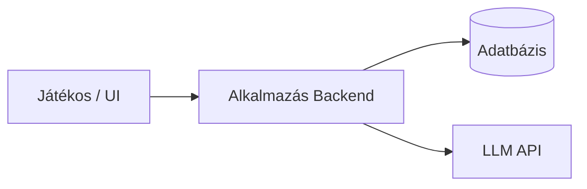

# Rendszerspecifikáció: LLM-alapú szöveges kalandjáték

## 1. Szereplők és jogosultságok

| Szerep | Igény | Felelősség / hozzáférés |
| --- | --- | --- |
| Játékos | Dinamikus történet alakítása és haladásának mentése logikai ellentmondások nélkül. | Lépéseket tesz, interaktál a világgal, menti és betölti a játékot. |
| Rendszer (Háttérlogika) | A játékvilág integritásának és konzisztenciájának fenntartása. | Validálja a változásokat, kezeli az adatbázist és közvetít az LLM felé. |

## 2. Use case-ek / user storyk

### Játékmenet és történetalakítás

- **Szereplő:** Játékos
- **Előfeltétel:** A játékos elindított egy új játékot vagy betöltött egy meglévő mentést.
- **Fő folyamat:**
  1. A szereplő beírja vagy kiválasztja a kívánt cselekedetet a felületen.
  2. A rendszer lekéri a strukturált világmodellt az adatbázisból.
  3. A rendszer elküldi az aktuális állapotot és a játékos inputját az LLM-nek.
  4. Az LLM generálja a szöveges folytatást és strukturált (JSON) formában visszaadja a világ változásait.
  5. A háttérlogika ellenőrzi, hogy a változások érvényesek-e a determinisztikus szabályok szerint.
  6. A rendszer frissíti a világmodellt, eltárolja az új játékállást és megjeleníti a történetet.
- **Alternatív / hibafolyamatok:** Ha az LLM válasza sérült vagy olyan változást javasol, ami ellentmond a fix tényeknek (pl. zárt ajtón megy át kulcs nélkül), a rendszer felülbírálja a módosítást és a determinisztikus modell állapotát tartja meg.
- **Utófeltétel:** A játékvilág állapota konzisztens marad, a játékos haladása perzisztensen tárolódik.

## 3. Funkcionális követelmények

| Követelmény | Elfogadási kritérium | Prioritás |
| --- | --- | --- |
| A rendszer determinisztikus világmodellt kezel. | Külön, strukturált adatbázisban tárolja a helyszínek, tárgyak és NPC-k fix tulajdonságait. | Kötelező |
| Az LLM válaszok feldolgozása strukturált. | Az API-ból érkező válaszokból a rendszer képes kinyerni a környezeti változásokat JSON formátumban. | Kötelező |
| A játékállás menthető és betölthető. | Amikor a játékos újratölti az alkalmazást, a játékvilág állapota és a történet előzménye pontosan a mentett pontról folytatódik. | Kötelező |
| Automatizált állapotkezelési tesztek megléte. | Az alapvető állapotváltozásokat és logikai szabályokat automatizált tesztek validálják az AI integráció előtt. | Kötelező |
| Letisztult felhasználói felület biztosítása. | A játékos egy reszponzív felületen keresztül szöveges visszajelzést kap és inputot adhat meg. | Ajnánlott |
| Memóriakezelési stratégiák összehasonlítása. | Legalább két megközelítés (pl. kontextus-összegzés vs. RAG) összehasonlítása tokenhasználat és konzisztencia alapján. | Kötelező |

Prioritás: **Kötelező** = a végtermékhez szükséges; **Ajánlott** = fontos; **Lehetséges** = idő esetén opcionális.

## 4. Üzleti szabályok és korlátok

| Szabály vagy korlát | Indoklás |
| --- | --- |
| A világ fix tényeit és állapotait csak a determinisztikus háttérlogika írhatja felül. | Megakadályozza az LLM hallucinációiból eredő logikai bukfenceket. |
| Csak érvényes és validált JSON válaszok frissíthetik az adatbázist. | Megvédi a perzisztencia réteget a hibás vagy inkonzisztens adatoktól. |
| Az API kulcsok és titkos környezeti változók nem kerülhetnek publikus repozitóriumba. | Alapvető biztonsági és hozzáférés-védelmi követelmény. |

## 5. Felhasználói felület és munkafolyamat

A fő navigáció egy menürendszert (Új játék, Betöltés) és a játékoldalt tartalmazza. A játékoldalon jelenik meg a szöveges narratíva ablak, egy beviteli mező a játékos döntéseihez, valamint a mentési és betöltési vezérlők. A játékos a billentyűzetével gépel vagy opciókat választ ki. Minden sikeres kör után a felület azonnal frissül a legújabb történeti elemekkel és az aktuális inventory/állapot kijelzéssel.

## 6. Nem funkcionális követelmények

| Követelmény | Ellenőrzés módja |
| --- | --- |
| Az LLM kérés és a strukturált válasz feldolgozása normál hálózati körülmények között 5 másodpercen belül lefut. | Backend válaszidő-mérés és naplózás. |
| A tokenhasználat minimalizált és optimalizált a tesztelt memóriakezelési stratégia alapján. | Token-számlálók és API költségfigyelők elemzése a tesztkörök alatt. |
| A háttérben futó determinisztikus állapotellenőrzés és validáció 50 ms-on belül végrehajtódik. | Profilozó eszközök alkalmazása az állapotkezelő kódon. |
| Érvénytelen vagy megszakadt API-kérés nem törli vagy rontja el a korábban tárolt játékmentéseket. | Integrációs teszt szimulált hálózati hibákkal. |

## 7. Nyitott kérdések és kockázatok

| Kérdés / kockázat | Hatás | Felelős | Feloldás / döntés |
| --- | --- | --- | --- |
| Melyik memóriakezelési stratégia ad jobb konzisztenciát hosszú távon? | Alapvetően befolyásolja a játékmenet minőségét és a fenntartási költségeket. | Hallgató | Az első fázisban elvégzett benchmark és tokenköltség-összehasonlítás alapján dől el. |
| Az LLM hajlamos lehet nem követni a kért JSON sémát. | Megakaszthatja a játékmenetet és a validációs pipeline-t. | Hallgató | Szigorú structured outputs kényszerítés (pl. OpenAI JSON mode) és egy robusztus regex alapú fallback tisztító réteg kiépítése. |
| Hogyan kezeljük a túl komplex, előre nem látható játékosi interakciókat a sémában? | Korlátozhatja a játékos szabadságát vagy túlbonyolíthatja a sémát. | Hallgató | Rugalmas, hibrid (pl. kulcs-érték alapú vagy dokumentum) adatbázis-séma tervezése a korai szakaszban. |

## 8. Kezdeti technikai javaslat

### Javasolt megoldás

A javasolt rendszer egy reszponzív (webes vagy asztali) frontendből, egy egyedi állapotkezelő és validáló backendből, valamint egy relációs vagy dokumentumalapú adatbázisból áll, amely az LLM API-val kommunikál. A háttérprogram fogadja a játékos lépéseit, összefésüli az adatbázisból betöltött fix világállapottal, majd a prompt segítségével meghívja az LLM-et. A kapott JSON választ a backend validálja, végrehajtja az állapotváltozásokat az adatbázisban, és a tiszta narratívát visszaküldi a felhasználói felületre.

### Technológiai irány

| Terület | Jelölt technológia / megközelítés | Megfontolás oka | Nyitott kérdés / kockázat |
| --- | --- | --- | --- |
| Backend / Logika | TypeScript (Node.js) vagy Python | Könnyű JSON-feldolgozás, erős ökoszisztéma az LLM SDK-khoz és automatizált teszteléshez. | Ki kell választani a végleges nyelvet a kutatási szakasz után. |
| Adatbázis / Tárolás | PostgreSQL vagy MongoDB | Megbízható perzisztens tárolás a strukturált világállapotokhoz és játékmentésekhez. | A relációs vagy dokumentumalapú megközelítés támogatja-e jobban a dinamikus sémát? |
| AI Integráció | OpenAI API / Anthropic API / LangChain | Fejlett funkciók strukturált kimenetek (Structured Outputs) kényszerítésére. | Az API-k válaszideje és tokenköltségei. |
| Felhasználói felület | React / Svelte vagy könnyű asztali UI | Tiszta, reszponzív környezet a szöveges élmény és a mentések kezelésére. | Webes alkalmazásként vagy natív asztali appként fusson. |

### Kezdeti architektúravázlat

### Megvalósíthatóság és technikai kockázatok

| Kockázat / feltételezés | A 2. félévre tervezett validáció | Tartalék megközelítés |
| --- | --- | --- |
| Az LLM stabilan képes a világmódosításokat a kért JSON formátumban visszaadni. | Mintapromptok futtatása és a kimenetek automatizált sémavalidációja a prototípus fázisban. | Fix, kötöttebb választási opciók (gombok) felkínálása a teljesen szabad szöveges bevitel helyett. |
| A játékos haladása teljes fiókrendszer nélkül is biztonságosan menthető. | Helyi mentési fájlok (JSON export/import) vagy böngészőalapú session azonosítók használata. | Egyszerűsített, lokális perzisztencia réteg (pl. SQLite / LocalStorage). |
